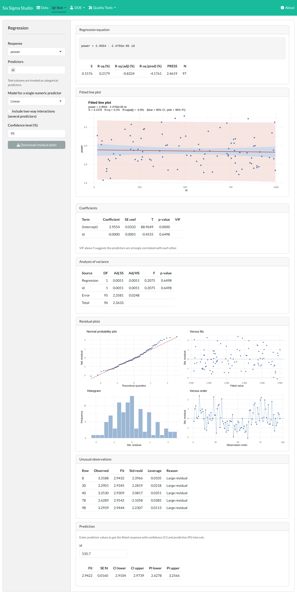
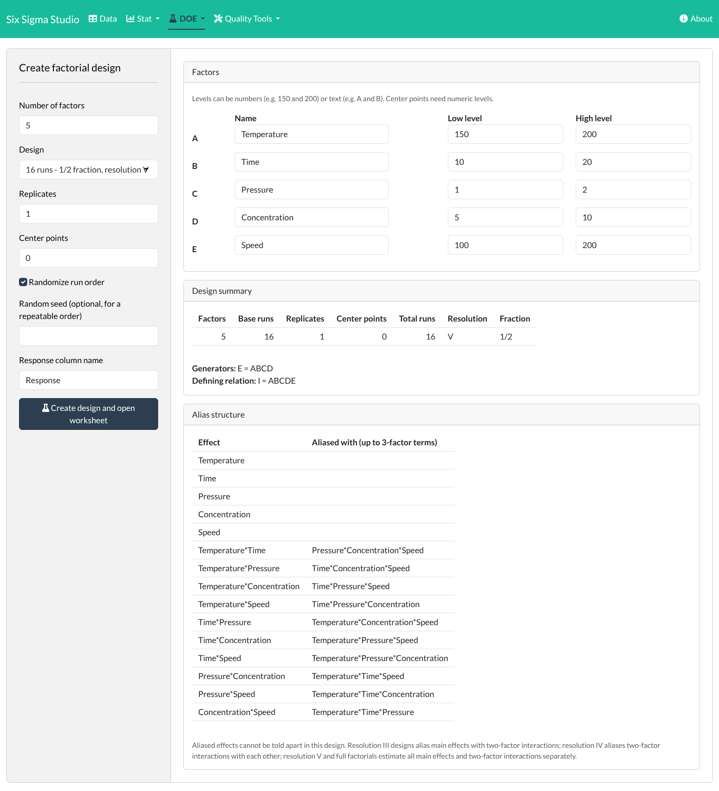
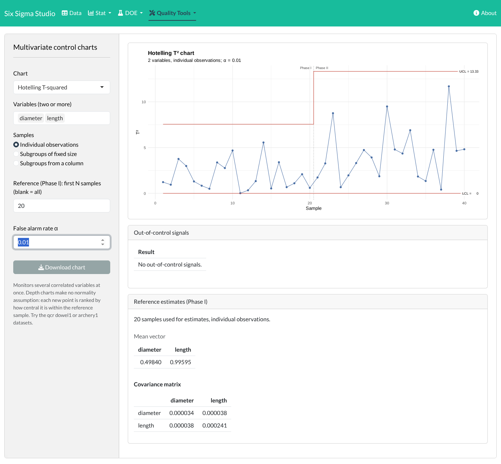
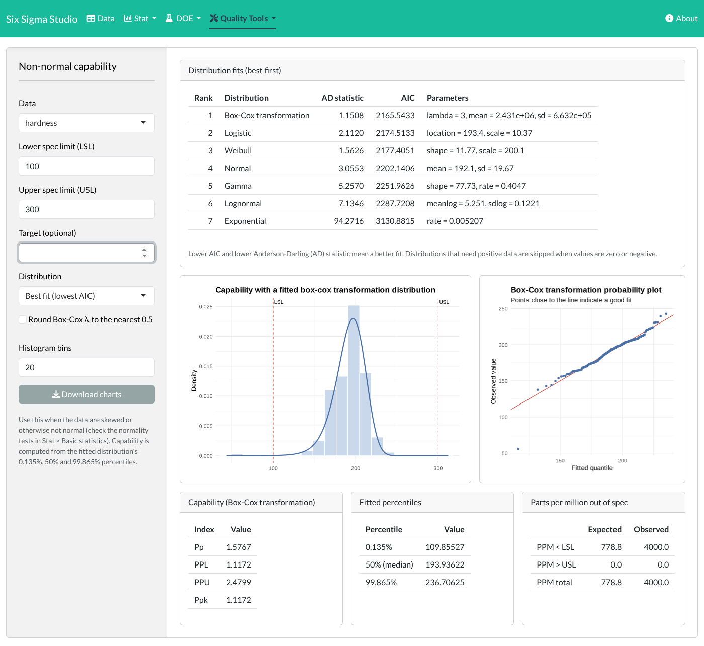
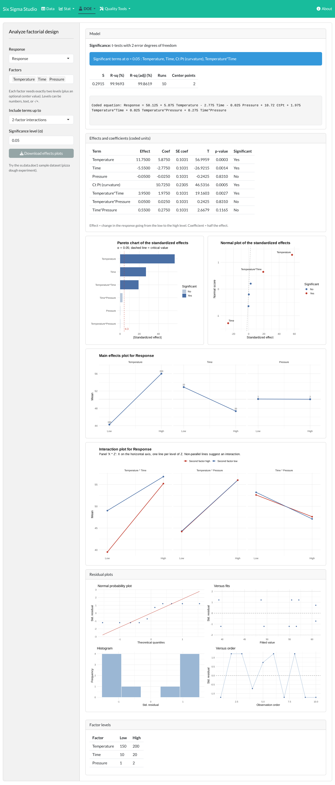
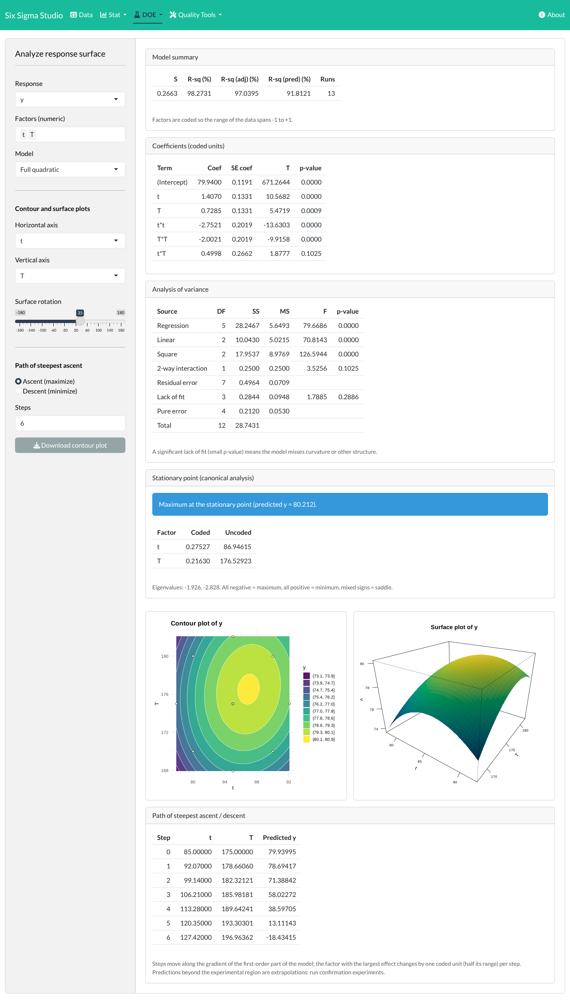
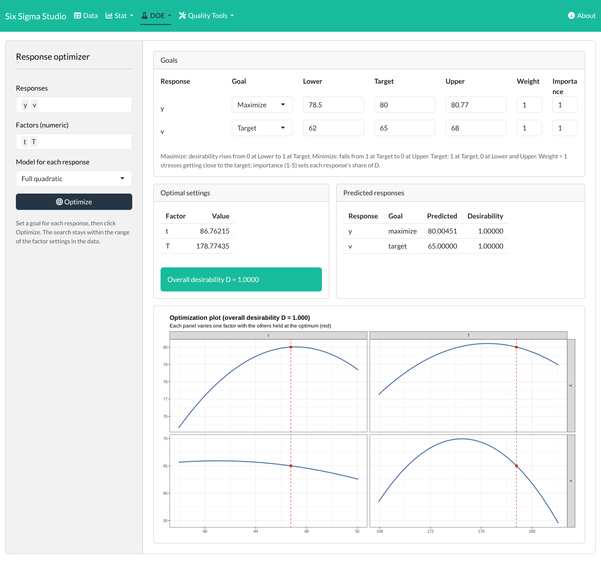

# Six Sigma Studio

A point-and-click desktop-style application for quality engineering, in the
spirit of Minitab's quality tools. It puts a graphical interface on the
open-source [SixSigma](https://cran.r-project.org/package=SixSigma) R package,
so you can run Six Sigma analyses **without writing any R code**.


## Features

| Menu | Analysis |
|---|---|
| **Data** | Load a sample dataset, upload CSV/Excel, or paste columns from a spreadsheet; edit cells, add columns, and export the worksheet |
| **Stat → Basic statistics** | Descriptive statistics (optionally by group), histogram with normal fit, normal probability plot, Anderson-Darling and Shapiro-Wilk tests, confidence interval for the mean |
| **Stat → Hypothesis tests** | 1-sample, 2-sample (Welch or pooled) and paired t-tests; one-way ANOVA with Tukey comparisons; equal variances (F/Bartlett and Levene); Mann-Whitney and Kruskal-Wallis; 1-proportion (exact) and 2-proportion tests; chi-square test of association. Each shows the hypotheses, a plain-language conclusion and a chart |
| **Stat → Regression** | Simple, quadratic/cubic and multiple linear regression (numeric and categorical predictors, optional interactions): equation, coefficients with VIF, R-sq/adjusted/predicted R-sq, ANOVA, fitted line plot with confidence and prediction bands, four-in-one residual plots, unusual observations, and predictions for new settings |
| **DOE → Create factorial / screening design** | Two-level full and fractional factorial designs for 2 to 8 factors using standard minimum-aberration generators, and Plackett-Burman screening designs (12, 20, 24 runs) for up to 23 factors; replicates, center points, randomized run order; resolution, defining relation and alias structure. The design opens in the worksheet, ready for you to type in results |
| **DOE → Analyze factorial design** | Effects and coefficients, Pareto and normal plots of standardized effects, main effects and interaction plots, curvature test from center points, residual plots. Unreplicated designs use Lenth's method; aliased terms are detected and reported |
| **DOE → Response surface designs** | Central composite (rotatable or face-centred) and Box-Behnken designs; analysis with linear, interaction or full quadratic models, lack-of-fit test, stationary point and canonical analysis, contour and 3-D surface plots, and the path of steepest ascent/descent |
| **DOE → Response optimizer** | Derringer-Suich desirability for one or several responses (maximize, minimize or target, with weights and importance), optimal settings, predicted responses and an optimization plot |
| **DOE → Mixture designs** | Simplex lattice and simplex centroid designs with optional axial check blends; Scheffé linear, quadratic and special cubic models; ternary contour plot and Cox trace plot |
| **DOE → Taguchi designs** | Orthogonal arrays L4, L8, L9, L12, L16, L18, L25, L27 and L32; S/N ratios (larger/smaller/nominal is best), response tables with delta and rank, main effects plots for S/N and means, and the predicted optimum |
| **Quality Tools → Capability analysis** | Cp, Cpk (within-subgroup sigma from moving ranges or pooled subgroups) and Pp, Ppk (overall), Cpm (Boyles interval) and Cpmk, all with confidence intervals; nonparametric CNp, CNpk, CNpm, CNpmk; Vännman capability plot; expected and observed PPM; the SixSigma capability report |
| **Quality Tools → Non-normal capability** | Fits normal, lognormal, Weibull, gamma, exponential, logistic and 3-parameter (threshold) lognormal, Weibull and gamma distributions or a Box-Cox transformation; ranks them by AIC and Anderson-Darling statistic, with simulated (parametric bootstrap) goodness-of-fit p-values; percentile-based Pp/Ppk and PPM with histogram and probability plots |
| **Quality Tools → Control charts** | I-MR, Xbar-R, Xbar-S, P, NP, C, U, EWMA and CUSUM charts; subgroups by size or column; variable sample sizes; limits from the first N points (Phase I/II) or a known mean and sigma; run-rule signals |
| **Quality Tools → Multivariate control charts** | Hotelling T² (individuals or subgroups, Phase I/II limits, variable contributions to each signal), MEWMA and MCUSUM; nonparametric data-depth r, Q and S charts (Mahalanobis or spatial depth) that need no normality assumption |
| **Quality Tools → Gage R&R** | Crossed or nested studies with variance components, % study variation, number of distinct categories, ANOVA and the six-panel report; generates a randomized study worksheet |
| **Quality Tools → Gage linearity and bias** | AIAG MSA linearity study: bias regressed on reference values, % linearity, average bias and bias per reference with t-tests |
| **Quality Tools → Type 1 gage study** | Cg and Cgk from repeated measurements of a reference part, bias test and run chart |
| **Quality Tools → Multi-vari chart** | Response by up to three factors (axis, lines, panels) to find the dominant source of variation |
| **Quality Tools → Loss function** | Taguchi loss function (nominal-, smaller- or larger-is-better) |
| **Quality Tools → Cause-and-effect diagram** | Ishikawa (fishbone) diagram from a simple text list |
| **Quality Tools → Pareto chart** | From typed counts, a category + count column, or one row per defect; cumulative percentage line, "vital few" highlighting and an optional "Other" group |
| **Quality Tools → Process yield** | Yield, first-time yield, rolled throughput yield, DPMO and sigma level |

Every chart can be downloaded as a PNG image.

| Control charts | Gage R&R |
|---|---|
|  |  |
| **Regression** | **Create factorial design** |
|  |  |
| **Multivariate control charts** | **Non-normal capability** |
|  |  |
| **Analyze factorial design** | **Hypothesis tests** |
|  |  |
| **Response surface** | **Response optimizer** |
|  |  |
| **Pareto chart** | |
|  | |

## Running it

1. Install [R](https://cran.r-project.org/) (version 4.1 or later).
2. Install the required packages (once, and again after updating the app). The
   script also upgrades packages that are too old, such as bslib versions
   before 0.5:

   ```bash
   Rscript install.R
   ```

3. Start the app from this folder:

   ```bash
   Rscript -e 'shiny::runApp(".", launch.browser = TRUE)'
   ```

   It opens in your web browser. In RStudio you can instead open `app.R` and
   click **Run App**.

   If the app reports that packages are outdated, close any running R or
   RStudio sessions, run `Rscript install.R` again, and restart.

## Project layout

```
app.R               Menus and page layout
R/mod_data.R        Worksheet: sample data, upload, paste, export
R/mod_basic.R       Basic statistics
R/mod_hypothesis.R  Hypothesis tests (user interface)
R/hyptests.R        Hypothesis test calculations
R/mod_capability.R  Capability analysis
R/mod_control.R     Control charts (user interface)
R/spc.R             Control chart calculations (Shewhart, EWMA, CUSUM) and run rules
R/mod_multivariate.R Multivariate control charts (user interface)
R/multivariate.R    T², MEWMA, MCUSUM and data-depth r/Q/S charts
R/capability.R      Capability indices, nonparametric indices, Vännman plot
R/mod_nonnormal.R   Non-normal capability (user interface)
R/capability_nonnormal.R Distribution fitting, Box-Cox, percentile indices
data/qcr/           Example datasets from the qcr package (see its README)
R/mod_gage.R        Gage R&R
R/mod_regression.R  Regression (user interface)
R/regression.R      Regression calculations and plots
R/mod_doe.R         DOE: create and analyze designs (user interface)
R/doe.R             Design generation, alias structure, effects analysis
R/designs_extra.R   Plackett-Burman, CCD, Box-Behnken, mixture and Taguchi designs
R/rsm.R             Response surface models, stationary point, contour/surface plots
R/mod_rsm.R         Response surface screens
R/desirability.R    Desirability functions and the response optimizer
R/mod_optimizer.R   Response optimizer screen
R/taguchi_mixture.R Taguchi S/N analysis, Scheffé mixture models, ternary plots
R/mod_taguchi_mixture.R Taguchi and mixture screens
R/msa_extra.R       Type 1 gage study, linearity and bias, R&R worksheet, multi-vari
R/mod_msa_extra.R   Screens for the above
R/mod_pareto.R      Pareto chart
R/mod_tools.R       Loss function, cause-and-effect diagram, yield
R/utils.R           Shared helpers
tests/testthat/     Unit tests for every calculation module
```

## How the analyses are computed

Hypothesis tests use R's standard `stats` functions (`t.test`, `aov`,
`TukeyHSD`, `var.test`, `bartlett.test`, `wilcox.test`, `kruskal.test`,
`binom.test`, `prop.test`, `fisher.test`, `chisq.test`); Levene's test is the
Brown-Forsythe form (ANOVA on absolute deviations from group medians).

Regression uses `lm`; predicted R-sq comes from the PRESS statistic. Factorial
designs use the standard generators from Box, Hunter & Hunter and Montgomery
(the tests check that every design is balanced and orthogonal), and the effects
analysis reproduces Montgomery's unreplicated 2^4 filtration-rate example,
including Lenth's pseudo standard error.

Capability, Gage R&R, loss function, cause-and-effect, yield and confidence
intervals call the SixSigma package directly, so the results are the
package's own.

SixSigma only provides a moving-range chart, so the other control charts are
computed in `R/spc.R` with the standard Shewhart formulas, using SixSigma's
exact d2, d3 and c4 constants. The tests check these limits against the
SixSigma moving-range chart and against the tabulated A2, A3, B4, D3 and D4
constants:

```bash
Rscript -e 'testthat::test_dir("tests/testthat")'
```

Run rules flagged on control charts: a point beyond the control limits; nine
points in a row on one side of the centre line; six points in a row steadily
increasing or decreasing.

### Methods adapted from qcr

EWMA, CUSUM, the multivariate and depth-based charts, the extended capability
indices and non-normal capability follow the
[qcr](https://github.com/mflores72000/qcr) package (Flores, Fernández-Casal,
Naya, Tarrío-Saavedra). They are reimplemented here, so the app needs neither
qcc nor fda.usc, and are checked against textbook examples (Montgomery's
CUSUM and EWMA examples), R's own functions and simulated data. Where this
app differs from qcr:

- MEWMA and MCUSUM on subgroup means use the covariance of the means (S/n).
- The depth S chart is standardized consistently before comparing with -z(α).
- The Cpm confidence interval uses Boyles' degrees of freedom n(1+ξ²)²/(1+2ξ²).
- Data depth offers Mahalanobis and spatial depth (qcr also has Tukey,
  simplicial and random-projection depth through fda.usc).
- qcr's control charts for functional data are not included.

### Features modelled on r6qualitytools

Response surface and mixture designs, the desirability optimizer, Taguchi and
Plackett-Burman designs, gage linearity, the type 1 gage study, the multi-vari
chart and 3-parameter capability fits follow the feature set of
[r6qualitytools](https://github.com/Fabianenc/r6qualitytools) (Encarnación,
Barahona, Flores et al., GPL-3). They are implemented here from the published
methods rather than copied. They are checked against textbook results:
Montgomery's response surface example 11.2 (stationary point 86.9, 176.5,
yield 80.21) and the yarn-elongation mixture example, the published Taguchi
arrays, Plackett-Burman orthogonality, and the AIAG and Bosch formulas.

The Taguchi L18 array uses Taguchi's published table. r6qualitytools 1.0.1
has two entries of column 8 swapped (rows 5 and 6), which leaves that column
unbalanced against columns 3 to 7; a test guards the published values.

## Credits and licence

Several methods and the example datasets in `data/qcr` come from the qcr
package by Miguel Flores, Rubén Fernández-Casal, Salvador Naya and Javier
Tarrío-Saavedra (GPL-2 or later).

The statistical engine is the SixSigma package by Emilio L. Cano, Javier M.
Moguerza, Mariano Prieto, Andrés Redchuk and contributors, from the books
*Six Sigma with R* and *Quality Control with R*.

This application is licensed under the GNU General Public License, version 2
or later, the same licence as the SixSigma package.
