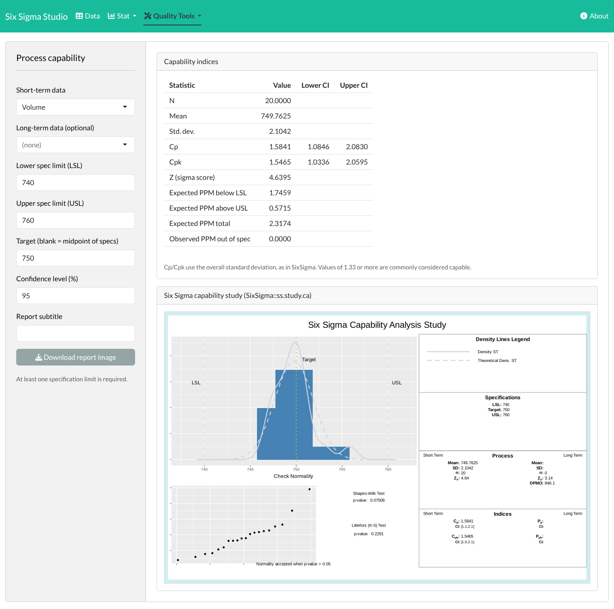
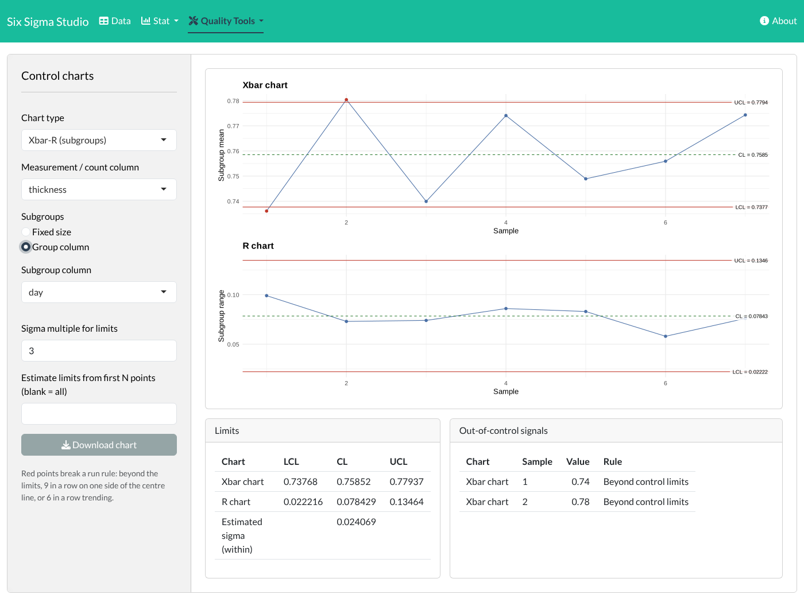
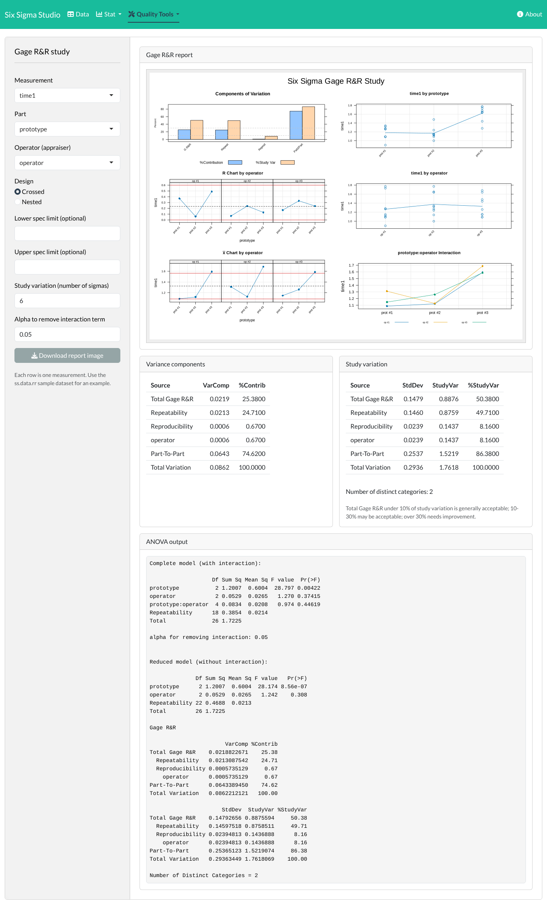
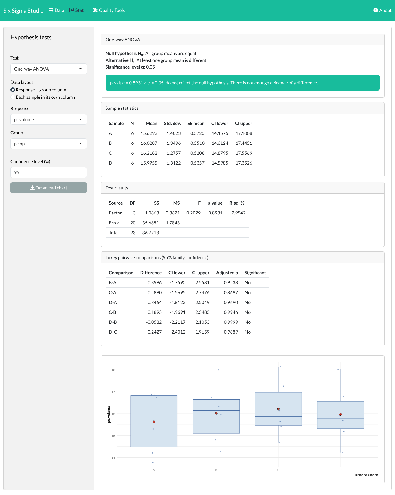
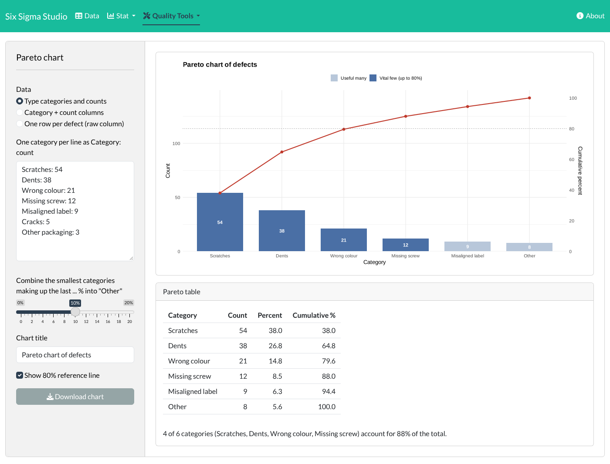

# Six Sigma Studio

A point-and-click desktop-style application for quality engineering, in the
spirit of Minitab's quality tools. It puts a graphical interface on the
open-source [SixSigma](https://cran.r-project.org/package=SixSigma) R package,
so you can run Six Sigma analyses **without writing any R code**.



## Features

| Menu | Analysis |
|---|---|
| **Data** | Load a sample dataset, upload CSV/Excel, or paste columns from a spreadsheet; browse and export the worksheet |
| **Stat → Basic statistics** | Descriptive statistics (optionally by group), histogram with normal fit, normal probability plot, Anderson-Darling and Shapiro-Wilk tests, confidence interval for the mean |
| **Stat → Hypothesis tests** | 1-sample, 2-sample (Welch or pooled) and paired t-tests; one-way ANOVA with Tukey comparisons; equal variances (F/Bartlett and Levene); Mann-Whitney and Kruskal-Wallis; 1-proportion (exact) and 2-proportion tests; chi-square test of association. Each shows the hypotheses, a plain-language conclusion and a chart |
| **Quality Tools → Capability analysis** | Cp, Cpk (with confidence intervals), Z score, expected and observed PPM, and the full SixSigma capability study report |
| **Quality Tools → Control charts** | I-MR, Xbar-R, Xbar-S, P, NP, C and U charts; subgroups by size or column; variable sample sizes; limits from the first N points (Phase I/II); run-rule signals |
| **Quality Tools → Gage R&R** | Crossed or nested studies with variance components, % study variation, number of distinct categories, ANOVA and the six-panel report |
| **Quality Tools → Loss function** | Taguchi loss function (nominal-, smaller- or larger-is-better) |
| **Quality Tools → Cause-and-effect diagram** | Ishikawa (fishbone) diagram from a simple text list |
| **Quality Tools → Pareto chart** | From typed counts, a category + count column, or one row per defect; cumulative percentage line, "vital few" highlighting and an optional "Other" group |
| **Quality Tools → Process yield** | Yield, first-time yield, rolled throughput yield, DPMO and sigma level |

Every chart can be downloaded as a PNG image.

| Control charts | Gage R&R |
|---|---|
|  |  |
| **Hypothesis tests** | **Pareto chart** |
|  |  |

## Running it

1. Install [R](https://cran.r-project.org/) (version 4.1 or later).
2. Install the required packages (once):

   ```bash
   Rscript install.R
   ```

3. Start the app from this folder:

   ```bash
   Rscript -e 'shiny::runApp(".", launch.browser = TRUE)'
   ```

   It opens in your web browser. In RStudio you can instead open `app.R` and
   click **Run App**.

## Project layout

```
app.R               Menus and page layout
R/mod_data.R        Worksheet: sample data, upload, paste, export
R/mod_basic.R       Basic statistics
R/mod_hypothesis.R  Hypothesis tests (user interface)
R/hyptests.R        Hypothesis test calculations
R/mod_capability.R  Capability analysis
R/mod_control.R     Control charts (user interface)
R/spc.R             Control chart calculations and run rules
R/mod_gage.R        Gage R&R
R/mod_pareto.R      Pareto chart
R/mod_tools.R       Loss function, cause-and-effect diagram, yield
R/utils.R           Shared helpers
tests/testthat/     Unit tests for control charts, hypothesis tests and Pareto
```

## How the analyses are computed

Hypothesis tests use R's standard `stats` functions (`t.test`, `aov`,
`TukeyHSD`, `var.test`, `bartlett.test`, `wilcox.test`, `kruskal.test`,
`binom.test`, `prop.test`, `fisher.test`, `chisq.test`); Levene's test is the
Brown-Forsythe form (ANOVA on absolute deviations from group medians).

Capability, Gage R&R, loss function, cause-and-effect, yield and confidence
intervals call the SixSigma package directly, so the results are the
package's own.

SixSigma only provides a moving-range chart, so the other control charts are
computed in `R/spc.R` with the standard Shewhart formulas, using SixSigma's
exact d2, d3 and c4 constants. The tests check these limits against the
SixSigma moving-range chart and against the tabulated A2, A3, B4, D3 and D4
constants:

```bash
Rscript -e 'testthat::test_dir("tests/testthat")'
```

Run rules flagged on control charts: a point beyond the control limits; nine
points in a row on one side of the centre line; six points in a row steadily
increasing or decreasing.

## Credits and licence

The statistical engine is the SixSigma package by Emilio L. Cano, Javier M.
Moguerza, Mariano Prieto, Andrés Redchuk and contributors, from the books
*Six Sigma with R* and *Quality Control with R*.

This application is licensed under the GNU General Public License, version 2
or later, the same licence as the SixSigma package.
